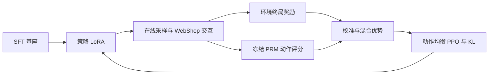

# Action-level SPA-GRPO

**面向 WebShop 多约束购物任务的动作级强化学习实验。** 在 GRPO 中引入独立过程奖励模型（PRM），探索从轨迹级优势到动作级训练信号的扩展。

[核心算法](docs/algorithm.md) · [训练入口](docs/training.md) · [实验结果](docs/results.md) · [代码导航](docs/code-map.md) · [模型架构](docs/model-architecture.md)

## 问题与实现

购物 Agent 能完成搜索、点击，不代表最终商品同时满足价格、颜色和规格要求。普通 GRPO 将同一终局优势分配给整条轨迹，无法直接区分中间决策的作用。本项目实现了：

- **动作级优势：**独立 PRM 评分 → 末步奖励校准 → 同深度剩余回报标准化 → 与 outcome 优势混合。
- **动作均衡优化：**动作内 token 平均、轨迹内动作等权；策略损失与 KL 使用一致的权重和 mask，并处理零方差、评分异常和不完整生成。
- **训练系统接入：**自定义 WebShop AgentLoop；三卡 FSDP 训练 LoRA、一卡冻结 PRM 评分；通过零权重补位和全局归一化适配跨卡训练。



## 实验结果

同一组 **1,210 个测试任务**，贪心生成，以环境满分作为成功标准：

| 模型 | 成功率 | 平均奖励 |
|---|---:|---:|
| SFT | 28.84% | 0.6301 |
| 普通 GRPO（V0） | 38.60% | 0.6510 |
| **动作级 SPA-GRPO** | **47.02%** | **0.7155** |

最终系统较已有普通 GRPO 基线提高 **8.43 个百分点**。**训练初始化和预算不同，这不是严格算法消融，不能把全部差值归因于 PRM 或动作优势。** 精确结果、动作解析统计和 token 开销见[实验报告](docs/results.md)。

## 从哪里开始看

| 你关心的问题 | 建议入口 |
|---|---|
| 动作回报和优势怎么算？ | [action_grpo.py](spa_next/algorithms/action_grpo.py) / [公式与局限](docs/algorithm.md) |
| token loss 与动作权重怎么算？ | [losses.py](spa_next/algorithms/losses.py) |
| 如何采样、训练和评估？ | [训练入口与前置条件](docs/training.md) |
| 模型结构、LoRA 与 PRM 接在哪里？ | [模型架构详解](docs/model-architecture.md) |
| PRM 如何训练？ | [model.py](spa_next/prm/model.py)、[train.py](spa_next/prm/train.py) |
| 哪些是核心代码，哪些是历史实验脚本？ | [代码导航](docs/code-map.md) |

## 运行与材料状态

本仓库提供新增实现、测试和脱敏结果汇总。WebShop 环境及数据需要从上游准备；训练依赖固定版本的 verl 补丁。**不是下载后即可一键复现的完整实验包。**

原实验权重和 checkpoint 已清理，未在仓库发布；复跑需要重新准备 SFT/PRM 和策略权重。历史结果仍可由保留的记录核查，完整轨迹和私有运行日志未公开。

已有对应依赖后可运行定向测试：

```bash
python -m unittest discover -s spa_next/tests -v
```

环境准备和训练参数见[训练文档](docs/training.md)。

## 来源与贡献范围

基于 [SPA-RL-Agent](https://github.com/WangHanLinHenry/SPA-RL-Agent) 与 [SPA-RL 论文](https://arxiv.org/abs/2505.20732)。进展评分及终局总和监督来自原工作；本项目贡献是 **Qwen/verl 接入、动作级 GRPO 优势与损失设计、分布式适配和实验分析**。

PRM 总分拟合不保证动作归因正确，同深度也不等于同状态。本项目是研究实验，不宣称解决了因果信用分配或已部署真实电商业务。

保留上游 [MIT 许可证](LICENSE)；第三方模型、数据与组件遵循各自许可。
